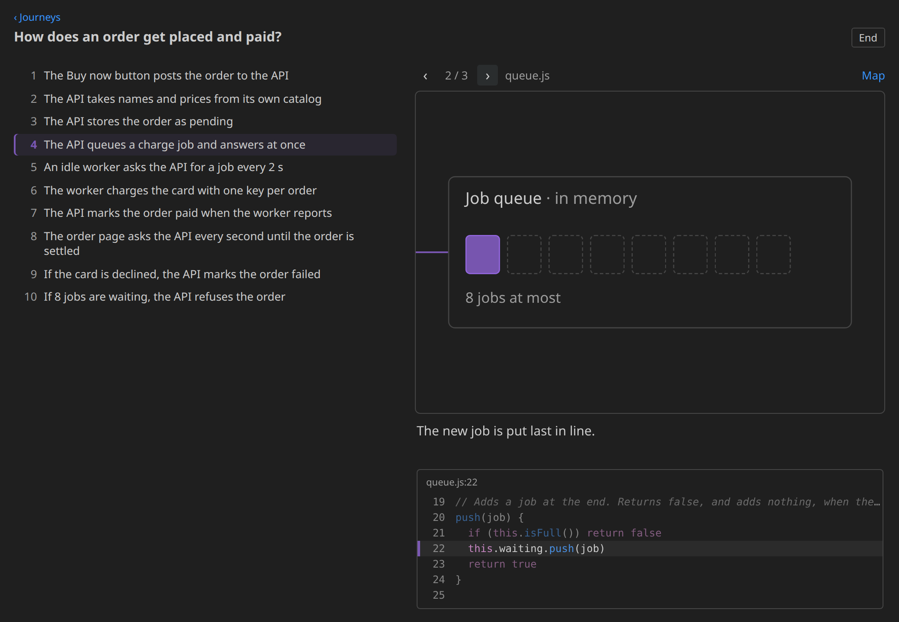
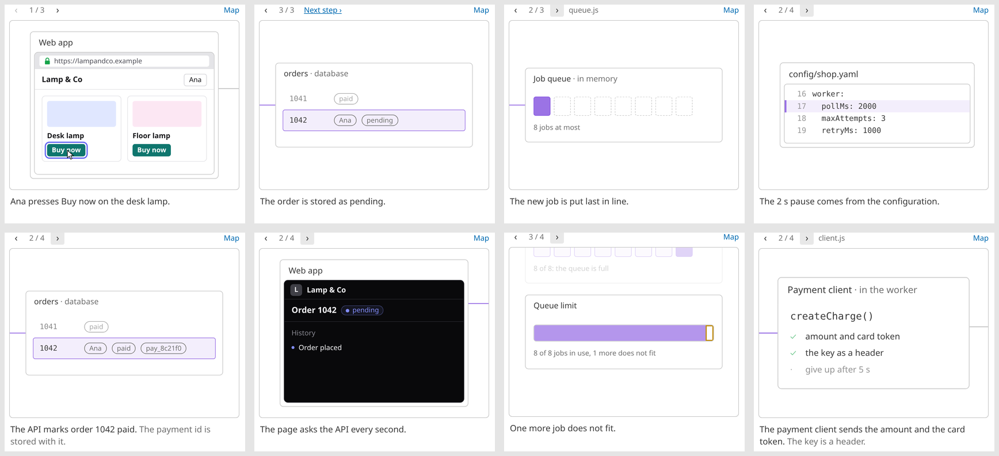

# Code Notes

Two things for understanding code you did not write, in VS Code:

- **Notes**: leave a question or a remark on any lines of code. Your coding agent answers in the thread; replies show
  up as unread.
- **Code Journeys**: an answer to "how does X work?" as a small map of the parts involved and a storyline of steps
  through the real code. You walk it step by step; a step can play as a short animation.



## Notes

- **Add one:** select code, press **Ctrl+'** then **C**, type, Ctrl+Enter. Or use the gutter `+`, or right-click →
  **Add Note**. A note can also be on a whole file or folder (right-click it in the Explorer).
- **Threads:** each note is a comment thread on its lines. Reply in the thread.
- **Answers from an agent** arrive as unread: a dot in the sidebar, a badge on the Code Notes icon, a bell in the
  status bar. With the [Claude Code](https://claude.com/claude-code) CLI installed, **Ask Claude** on a note answers
  it right there; any other agent can answer by editing the note files (see [Storage](#storage)).
- **Resolve:** ✓ on the thread or the list row; tick several and resolve them together. Resolved notes are hidden.
- **Suggestions:** an agent's ` ```suggestion ` block gets **Apply suggestion**, which replaces the note's lines.
- **Notes follow the code.** If the lines move, the note moves with them. If they change or disappear, the note is
  marked stale where the code is now, with **Keep here** and **Move**.

## Code Journeys

A journey is one JSON file in your repository (`journeys/` by default), reviewed in pull requests like code. Open one
from the Code Notes sidebar, or run **Ask a Question About the Code…** and have Claude Code write one.

- **The panel** shows the storyline (the numbered steps) beside a map of the systems, modules and functions involved.
- **In the editor**, a card above the step's lines says what happens there, with **Next**, **Ask** and **More**.
- **Code links:** tinted phrases in the card jump to the exact lines that do that part.
- **Value hints:** faint text above a line shows what a variable holds in an example run.
- **Show animation** plays the step beat by beat in place of the map. Each beat shows one thing happening, highlights
  the line of code that does it, and shows that line with a few around it under the caption.
- **Steps follow the code** like notes do: moved code is followed, changed code is flagged.



Animations are data in the journey file, drawn from a fixed set of objects: a terminal, a file, a service, a database
table, a cluster (with a cluster inside it), a web app window, a browser, a chat, a queue and a gauge.
[docs/journey-format.md](docs/journey-format.md) describes the format.

### Writing journeys

The extension ships with the `code-journey` skill for Claude Code: instructions plus a script that writes and checks
a journey, so every step points at real lines. **Ask a Question About the Code…** uses it. To change how journeys are
written in your repository, copy [skills/code-journey](skills/code-journey) to `.claude/skills/code-journey` there;
the repository's copy wins.

## Keys

One chord: **Ctrl+'** (or **Ctrl+<** on ISO keyboards), then a letter.

| Key | Does |
|---|---|
| **C** | New note on the selection |
| **R** | Resolve the note at the cursor and go to the next unread |
| **D** / **A** | Next / previous: the journey step while walking one, else the unread note |
| **V** | The journey map |
| **P** | The current step's animation, on or off |

## Requirements

- VS Code 1.100 or newer.
- Optional: the [Claude Code](https://claude.com/claude-code) CLI, for **Ask Claude** and for writing journeys. Claude
  never runs in an untrusted workspace, and it cannot edit your files: it answers in notes and writes journey files.
- Optional: Python 3, used by the journey skill's script.

## Storage

One JSON file per note in `.code-notes/` of your workspace (setting `codeNotes.folder`). The extension writes a
`README.md` there that describes the format for agents. To have any agent answer, ask it: *"Answer my open code notes
in .code-notes/"*. What you have read is kept per person in VS Code, not in the files.

Journeys live in `journeys/` (setting `codeNotes.journeys.folder`); personal ones in `.code-notes/journeys/` are read
too.

## Settings

The extension turns on smooth editor scrolling by default, so the editor glides between a journey's steps. Set
`editor.smoothScrolling` to `false` to switch that off. All other settings are under **Code Notes** in the Settings
editor.

## Development

```sh
npm ci
npm test                    # unit tests
npm run test:integration    # the extension in a real VS Code (needs a display, or xvfb)
npm run package             # code-notes-<version>.vsix
```

Open the folder in VS Code and press F5 ("Code Notes (dev)") for a window that reloads itself when the code changes.

Releases: see [CHANGELOG.md](CHANGELOG.md). Pushing a tag `v<version>` publishes that version.

## License

[MIT](LICENSE)
