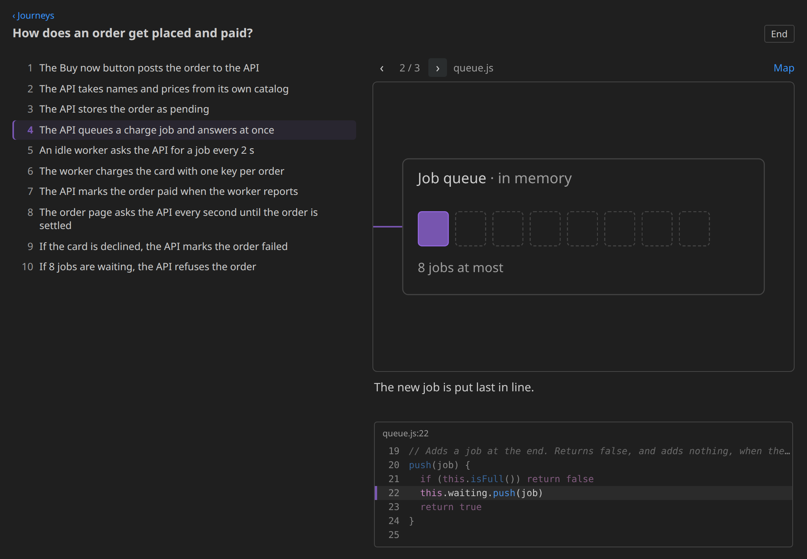

# Code Notes

Three things for understanding code you did not write, in VS Code:

- **Notes**: leave a question or a remark on any lines of code. Your coding agent answers in the thread; replies show
  up as unread.
- **Code Journeys**: an answer to "how does X work?" as a small map of the parts involved and a storyline of steps
  through the real code. You walk it step by step; a step can play as a short animation.
- **Understanding check**: before you merge a change (yours, or your agent's), answer a few short questions about
  it next to the code. A merge request check makes sure it was done.



## Notes

- **Add one:** select code, press **Ctrl+'** then **C**, type, Ctrl+Enter. Or right-click → **Add Note**. A note can also be on a whole file or folder (right-click it in the Explorer).
- **Threads:** each note is a comment thread on its lines. Reply in the thread.
- **Answers from an agent** arrive as unread: a dot in the sidebar and a badge on the Code Notes icon. With the [Claude Code](https://claude.com/claude-code) CLI installed, **Ask Claude** on a note answers
  it right there; any other agent can answer by editing the note files (see [Storage](#storage)).
- **Resolve:** ✓ on the thread or the list row; tick several and resolve them together. Resolved notes are hidden.
- **Suggestions:** an agent's ` ```suggestion ` block gets **Apply suggestion**, which replaces the note's lines.
- **Notes follow the code.** If the lines move, the note moves with them. If they change or disappear, the note is
  marked stale where the code is now, with **Keep here** and **Move**.

## Code Journeys

A journey is one JSON file in your repository (`journeys/` by default), reviewed in pull requests like code. Open one
from the **Journeys** view in the Code Notes sidebar, or run **Ask a Question About the Code…** and have Claude Code
write one.

- **Finding one:** the Journeys view groups them: **In this file** (journeys with a step in the file you are in),
  **Continue**, **Checks**, then **All** by area (the top folder most steps visit). Search and sort are in its title
  bar. The panel's **‹ Journeys** list has the same groups, a search field (it also searches step titles and file
  paths), chips by kind and area, and a preview of the selected journey; Enter walks it.

- **The panel** shows the storyline (the numbered steps) beside a map of the systems, modules and functions involved.
  It never leaves the code under 80 columns: in a narrower window the walk uses the step card alone (Ctrl+' V: the map).
- **In the editor**, a card above the step's lines says what happens there, with **Next**, **Ask** and **More**.
- **Code links:** tinted phrases in the card jump to the exact lines that do that part.
- **Value hints:** faint text above a line shows what a variable holds in an example run.
- **Show animation** plays the step beat by beat in place of the map. Each beat shows one thing happening, highlights
  the line of code that does it, and shows that line with a few around it under the caption.
- **Steps follow the code** like notes do: moved code is followed, changed code is flagged. Your own edits to a
  step's lines (typing, an applied fix) are followed, not flagged.
- **Listen:** a journey with an audio episode next to it (`<journey>.podcast.json`) has ▶ Listen on its row. The walk
  follows the voice: each step's code opens, the animation moves beat by beat, the caption shows the sentence being
  said. The timeline is marked by step; click or drag anywhere and the walk is exactly where it is at that time. The
  storyline becomes the chapter list (▶ for one step, the transcript of the step being said). The audio plays in the
  Listen view, so it goes on when the journey panel is closed or VS Code is in the background.
  [docs/podcast-format.md](docs/podcast-format.md) describes the format and its checks: problems show in the
  Problems view, and a podcast that can't play says why in its row's tooltip.


Animations are data in the journey file, drawn from a fixed set of objects: a terminal, a file, a service, a database
table, a cluster (with a cluster inside it), a web app window, a browser, a chat, a queue and a gauge.
[docs/journey-format.md](docs/journey-format.md) describes the format.

### Writing journeys

The extension ships with the `code-journey` skill for Claude Code: instructions plus a script that writes and checks
a journey, so every step points at real lines. **Ask a Question About the Code…** uses it. To change how journeys are
written in your repository, copy [skills/code-journey](skills/code-journey) to `.claude/skills/code-journey` there;
the repository's copy wins.

## Understanding check

**Code Notes: Check my understanding** has Claude Code ask a few questions about your branch's change. You answer
them next to the code, Claude grades each answer, and a short tour of the change walks you through the code that holds
the answers. The answers are saved in `understanding/<branch>.json`; a CI job on GitLab or GitHub (no model, no key)
checks that file on the merge request. How to use it, its settings and the CI recipes:
[docs/understanding-check.md](docs/understanding-check.md).

## Keys

One chord: **Ctrl+'** (or **Ctrl+<** on ISO keyboards), then a letter.

| Key | Does |
|---|---|
| **C** | New note on the selection |
| **R** | Resolve the note at the cursor and go to the next unread |
| **D** / **A** | Next / previous: the journey step while walking one, else the unread note |
| **V** | The journey map |
| **P** | The current step's animation, on or off |
| **J** | Search journeys |
| **Space** | Listen: play or pause |
| **←** / **→** | Listen: back / forward 15 s |
| **Shift+←** / **Shift+→** | Listen: previous / next step |

## Requirements

- VS Code 1.100 or newer.
- Optional: the [Claude Code](https://claude.com/claude-code) CLI, for **Ask Claude**, writing journeys and the
  understanding check. Claude
  never runs in an untrusted workspace, and it cannot edit your files: it answers in notes and writes journey files.
- Optional: Python 3, used by the journey skill's script.

## Storage

One JSON file per note in `.code-notes/` of your workspace (setting `codeNotes.folder`). The extension writes a
`README.md` there that describes the format for agents. To have any agent answer, ask it: *"Answer my open code notes
in .code-notes/"*. What you have read is kept per person in VS Code, not in the files.

Journeys live in `journeys/` (setting `codeNotes.journeys.folder`); personal ones in `.code-notes/journeys/` are read
too.

## Settings

The extension changes two VS Code defaults; a value in your own settings wins:

| Default | Why | To undo |
|---|---|---|
| `comments.openView`: `never` | the Comments panel doesn't pop up for every note (this applies to other comment extensions too) | `"comments.openView": "firstFile"` |
| `editor.smoothScrolling`: `true` | the editor glides between a journey's steps | `"editor.smoothScrolling": false` |

All other settings are under **Code Notes** in the Settings editor, named by what they are about:

| Prefix | About |
|---|---|
| `codeNotes.*` (no group) | notes: your name, their folder and git, how they show in the editor |
| `codeNotes.claude.*` | the Claude Code CLI that answers notes: on or off, its path, model and skills |
| `codeNotes.claudeLinks` | code links in a Claude Code chat |
| `codeNotes.journeys.*` | journeys: their folder, the code lens, author mode, the model that writes them |
| `codeNotes.listen.*` | listening to a journey: how long the code waits for you |
| `codeNotes.understanding.*` | the understanding check: the model that writes and grades it, background questions |

The settings that choose what runs (the CLI, the models, the skills) are taken only from your user settings in a
workspace you have not trusted.

## License

[MIT](LICENSE)
