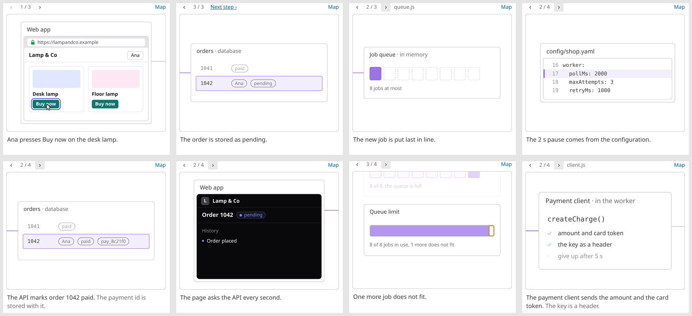

# Code Notes

Three things for understanding code you did not write, in VS Code:

- **Notes**: leave a question or a remark on any lines of code. Your coding agent answers in the thread; replies show
  up as unread.
- **Code Journeys**: an answer to "how does X work?" as a small map of the parts involved and a storyline of steps
  through the real code. You walk it step by step; a step can play as a short animation.
- **Understanding check**: before you merge a change (yours, or your agent's), answer 3-5 short questions about it
  next to the code. A merge request check makes sure it was done.


## Notes

- **Add one:** select code, press **Ctrl+'** then **C**, type, Ctrl+Enter. Or use the gutter `+`, or right-click →
  **Add Note**. A note can also be on a whole file or folder (right-click it in the Explorer).
- **Threads:** each note is a comment thread on its lines. Reply in the thread.
- **Answers from an agent** arrive as unread: a dot in the sidebar, a badge on the Code Notes icon, a bell in the
  status bar. With the [Claude Code](https://claude.com/claude-code) CLI installed, **Ask Claude** on a note answers
  it right there; any other agent can answer by editing the note files (see [Storage](#storage)).
- **Resolve:** ✓ on the thread or the list row; tick several and resolve them together. Resolved notes are hidden.
- **Suggestions:** an agent's ` ```suggestion ` block gets **Apply suggestion**, which replaces the note's lines.
- **Notes follow the code.** If the lines move, the note moves with them. If they change or disappear, the note is
  marked stale where the code is now, with **Keep here** and **Move**.

## Code Journeys

A journey is one JSON file in your repository (`journeys/` by default), reviewed in pull requests like code. Open one
from the **Journeys** view in the Code Notes sidebar, or run **Ask a Question About the Code…** and have Claude Code
write one.

- **Finding one:** the Journeys view groups them: **In this file** (journeys with a step in the file you are in),
  **Continue**, **Checks**, then **All** by area (the top folder most steps visit). Search and sort are in its title
  bar. The panel's **‹ Journeys** list has the same groups, a search field (it also searches step titles and file
  paths), chips by kind and area, and a preview of the selected journey; Enter walks it.

- **The panel** shows the storyline (the numbered steps) beside a map of the systems, modules and functions involved.
- **In the editor**, a card above the step's lines says what happens there, with **Next**, **Ask** and **More**.
- **Code links:** tinted phrases in the card jump to the exact lines that do that part.
- **Value hints:** faint text above a line shows what a variable holds in an example run.
- **Show animation** plays the step beat by beat in place of the map. Each beat shows one thing happening, highlights
  the line of code that does it, and shows that line with a few around it under the caption.
- **Steps follow the code** like notes do: moved code is followed, changed code is flagged.



Animations are data in the journey file, drawn from a fixed set of objects: a terminal, a file, a service, a database
table, a cluster (with a cluster inside it), a web app window, a browser, a chat, a queue and a gauge.
[docs/journey-format.md](docs/journey-format.md) describes the format.

### Writing journeys

The extension ships with the `code-journey` skill for Claude Code: instructions plus a script that writes and checks
a journey, so every step points at real lines. **Ask a Question About the Code…** uses it. To change how journeys are
written in your repository, copy [skills/code-journey](skills/code-journey) to `.claude/skills/code-journey` there;
the repository's copy wins.

## Understanding check

**Code Notes: Check my understanding** (or the **Check** item in the status bar) has Claude Code read your branch's
change and ask a few questions about it (1 for a small change, up to 5 for a big one): how a part behaves, why it is built this way, how it fails. Each question opens
as a thread on its lines. Answer in 1-3 sentences and press Ctrl+Enter: Claude checks the answer against the code and
replies in the thread. A miss gets a hint and a second try; a second miss gets the explanation, and you move on.

Questions and answers are saved in `understanding/<branch>.json`. Once every question is done and enough answers pass
(60 % by default), the panel says **Commit and push**. Commit it with your change.

Everything runs on your machine. The merge request check only verifies the file: it belongs to this change, every
question is done, the recorded verdicts meet the threshold. It calls no model and needs no key. Once the check is done
it posts the questions and answers on the merge request for the reviewer (while it is in progress, only "2 of 4 done"). It is easy to cheat by editing the file; it is there to
make you look, not to police.

- **Every change with code** gets a check; only code lines count (not comments or blank lines). Files that should
  never count go in `exempt` (none by default).
- **The change grew** by more than 40 code lines since the questions: run the command again; it adds 1-2 questions
  about the new part only. Merging the target branch in doesn't count.
- **Skip it:** label the merge request `skip-understanding`. Any approval by someone other than the author waives the
  check (re-run the job after the approval; on GitHub the review re-runs it).
- **Settings** for a repository: `understanding/config.json`, e.g.
  `{ "exempt": ["docs/**", "*.md", "package-lock.json"], "passRatio": 0.6, "maxDrift": 40, "skipLabel": "skip-understanding", "mrComment": true }`.

Only the final answer to each question is kept in the file; earlier tries keep their verdict, not their text.

To keep the files out of diffs and search, run `node cli/understanding.mjs init` once (VS Code does it on the first
check). It adds `understanding/*.json linguist-generated=true` to `.gitattributes` (collapsed in GitLab/GitHub diffs) and
`understanding/` to `.ignore` (skipped by ripgrep), never twice.

The command line, [cli/understanding.mjs](cli/understanding.mjs) (Node 18+, no dependencies): `status`, `validate`,
`grade` (local; Claude Code or `ANTHROPIC_API_KEY`), `init` and `ci`. Design: [docs/understanding-check.md](docs/understanding-check.md).

### In CI

GitLab (`.gitlab-ci.yml`). `GITLAB_TOKEN`: a project access token with `api` scope (CI/CD variable, masked), used to
read labels and approvals and to write the comment. Without it the check still runs, without the comment and the skip
label.

```yaml
understanding:
  image: node:22
  rules:
    - if: $CI_PIPELINE_SOURCE == "merge_request_event"
  variables:
    GIT_DEPTH: "0"
  allow_failure:
    exit_codes: [3]   # advisory mode: "passed with warnings", never blocks
  script:
    - curl -fsSL https://raw.githubusercontent.com/tomeyer97/code-notes/v0.24.0/cli/understanding.mjs -o /tmp/understanding.mjs
    - node /tmp/understanding.mjs ci
```

GitHub Actions (`.github/workflows/understanding.yml`); an approving review re-runs it by itself:

```yaml
name: Understanding check
on:
  pull_request:
    types: [opened, synchronize, reopened, labeled, unlabeled]
  pull_request_review:
    types: [submitted]
permissions:
  contents: read
  pull-requests: write
jobs:
  understanding:
    runs-on: ubuntu-latest
    steps:
      - uses: actions/checkout@v4
        with:
          fetch-depth: 0
      - uses: actions/setup-node@v4
        with:
          node-version: 22
      - run: |
          curl -fsSL https://raw.githubusercontent.com/tomeyer97/code-notes/v0.24.0/cli/understanding.mjs -o /tmp/understanding.mjs
          node /tmp/understanding.mjs ci
        env:
          GITHUB_TOKEN: ${{ secrets.GITHUB_TOKEN }}
```

**Advisory first.** Start with `"mode": "advisory"` in `understanding/config.json` for a month, then switch to
`"required"` (the default; `UNDERSTANDING_MODE` overrides the file). In advisory mode the job and the merge request
comment work as usual, but a failure doesn't block: on GitLab the job exits 3 and shows "passed with warnings" (the
`allow_failure` above); on GitHub, where a step can't allow one exit code, it adds a warning annotation and passes.

To review the script once and keep it, commit a copy (e.g. `tools/understanding.mjs`) and run that instead.

## Keys

One chord: **Ctrl+'** (or **Ctrl+<** on ISO keyboards), then a letter.

| Key | Does |
|---|---|
| **C** | New note on the selection |
| **R** | Resolve the note at the cursor and go to the next unread |
| **D** / **A** | Next / previous: the journey step while walking one, else the unread note |
| **V** | The journey map |
| **P** | The current step's animation, on or off |

## Requirements

- VS Code 1.100 or newer.
- Optional: the [Claude Code](https://claude.com/claude-code) CLI, for **Ask Claude**, writing journeys and the
  understanding check. Claude
  never runs in an untrusted workspace, and it cannot edit your files: it answers in notes and writes journey files.
- Optional: Python 3, used by the journey skill's script.

## Storage

One JSON file per note in `.code-notes/` of your workspace (setting `codeNotes.folder`). The extension writes a
`README.md` there that describes the format for agents. To have any agent answer, ask it: *"Answer my open code notes
in .code-notes/"*. What you have read is kept per person in VS Code, not in the files.

Journeys live in `journeys/` (setting `codeNotes.journeys.folder`); personal ones in `.code-notes/journeys/` are read
too.

## Settings

The extension turns on smooth editor scrolling by default, so the editor glides between a journey's steps. Set
`editor.smoothScrolling` to `false` to switch that off. All other settings are under **Code Notes** in the Settings
editor.

## Development

```sh
npm ci
npm test                    # unit tests
npm run test:integration    # the extension in a real VS Code (needs a display, or xvfb)
npm run package             # code-notes-<version>.vsix
```

Open the folder in VS Code and press F5 ("Code Notes (dev)") for a window that reloads itself when the code changes.

Releases: see [CHANGELOG.md](CHANGELOG.md). Pushing a tag `v<version>` publishes that version.

## License

[MIT](LICENSE)
